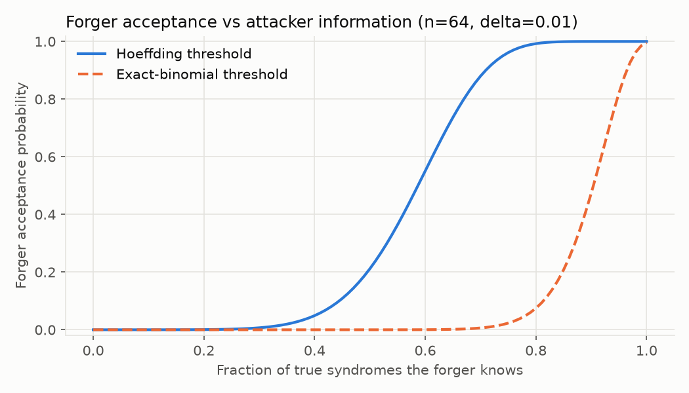
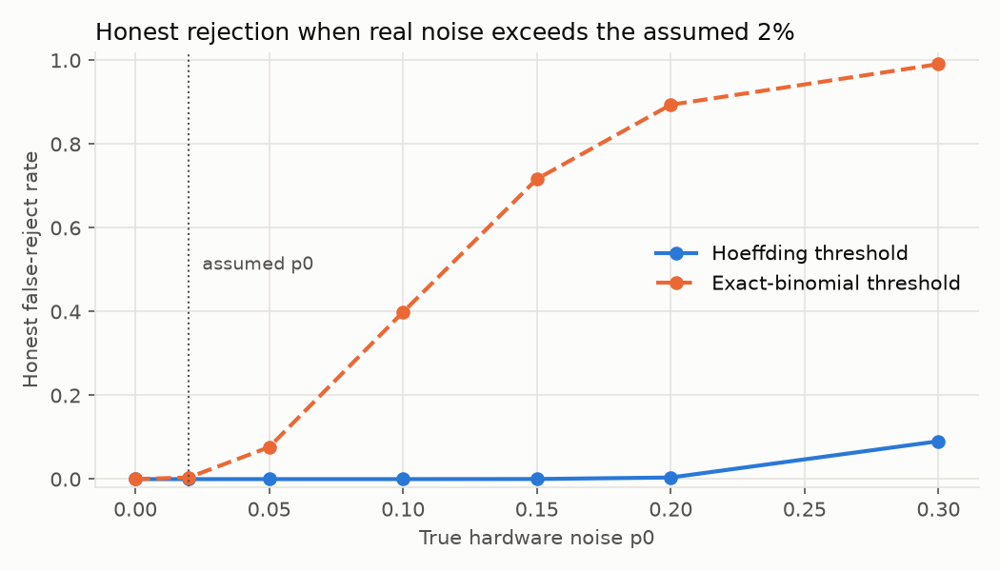

# ROC_ANALYSIS.md: Attack-Strength Analysis of the Q-STDF Detector

Generated by `python scripts/roc_benchmark.py`. All curves are exact binomial calculations, cross-checked
against the project's own verifier model (`QiskitAerEngine.simulate_bob_verification`).

## Why this exists

The headline "100% detection" compares honest signatures with attackers who know nothing. That split is true by
construction. This analysis varies **attacker strength** instead, and shows where the detector actually stops working.

## Attackers modelled

- **Partial-information forger.** Knows each true syndrome with probability f, guesses the rest.
  Per-position mismatch probability is `f*p0/2 + (1-f)/2`.
- **In-flight tamperer.** Flips each syndrome bit with probability r. Mismatch probability is `(1-r)*p0/2 + r*(1-p0/2)`.

## Model check

| Quantity | Closed form | Measured through verifier model |
|---|---|---|
| Honest mismatch rate | 0.0100 | 0.0093 |
| Random-guess mismatch rate | 0.5000 | 0.4984 |
| Partial information, f=0.5 | 0.2550 | 0.2573 |
| Tampering, r=0.3 | 0.3040 | 0.3001 |

## Finding 1: the Hoeffding threshold is far looser than it needs to be

With depolarizing noise p0 = 0.02, an honest bit is wrong with probability p0/2 = 0.01, not p0. Hoeffding adds a
generous slack on top. At n = 64, delta = 0.01, the real false-reject rate of the Hoeffding threshold
(0.2097) is about 3.0e-15, against a budget of 0.01. The slack is paid for by forgery security.

An exact-binomial threshold (0.0469, i.e. at most 3 mismatches of 64)
keeps the same false-reject guarantee and is much tighter.

| n | tau (Hoeffding) | tau (exact) | Forger info needed, Hoeffding | Forger info needed, exact | MITM flip rate tolerated, Hoeffding | MITM flip rate tolerated, exact |
|---|---|---|---|---|---|---|
| 32 | 0.2882 | 0.0625 | 41% | 85% | 29.4% | 7.4% |
| 64 | 0.2097 | 0.0469 | 59% | 90% | 20.7% | 4.8% |
| 128 | 0.1541 | 0.0312 | 71% | 95% | 14.6% | 2.6% |

"Info needed" is the fraction of true syndromes a forger must know to be accepted half the time.
"Flip rate tolerated" is the largest syndrome-flip rate that is still accepted half the time.

## Finding 2: a tight threshold is fragile if the noise assumption is wrong

The exact threshold is only as good as the assumed p0. If real hardware is noisier than assumed, honest users get rejected.

Hoeffding tolerates a 5x noise error with a false-reject rate near 1e-9. The exact threshold at 5x noise (true p0 = 0.10)
rejects about 40% of honest signatures. Use the exact threshold only with a measured,
periodically re-calibrated noise estimate (for example an upper confidence bound from calibration runs), never a hard-coded constant.

## Limits of this analysis

- Independent, identically distributed errors are assumed. Real hardware has drift and correlated noise.
- "Partial information" is an abstract fraction. How an attacker would obtain it on real hardware is outside this model.
- Verification still reads the true syndromes from the Bob-side session store, which simulates entanglement.
  This analysis measures the statistical test, not the physical security of a deployed quantum channel.

Data: `roc_data.csv`. Opt-in: `QdsT1Protocol.verify(..., threshold_mode="exact")`.
